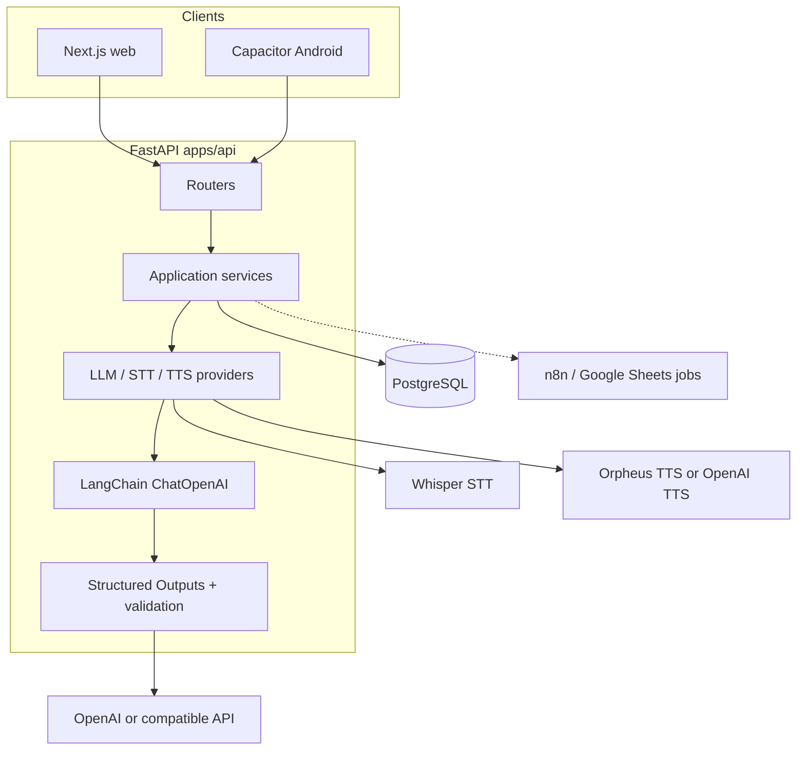

# Decime UY — An Applied AI Translation Assistant for Uruguayan Spanish

A translation application with locale-aware LLM translation, speech, personal vocabulary training, quality-evaluation pipelines, prompt versioning, and model testing.

[Русская версия](README.ru.md) · [Engineering case study](docs/case-study.md) · [Documentation index](docs/README.md)

---

## Project overview

General-purpose translators often miss Uruguayan Spanish (Rioplatense): *voseo*, informal register, and everyday expressions that matter in WhatsApp and face-to-face talk. Decime closes that gap with context-aware translation into **es-UY**, plus speech and a personal phrase list for practice.

Typical users are learners or people living in an environment where they need reliable Spanish for daily chat (UI in Russian or English). Main directions: **Spanish ↔ Russian/English**, with Uruguayan Spanish as the target locale for outbound replies.

```text
Incoming message or speech → understand / translate → es-UY reply → audio → approve phrases → review (SRS)
```

---

## Demo

| | URL |
|--|-----|
| Web app | https://decime.online |

Production requires sign-in. Public self-service registration is off by default (`AUTH_ALLOW_REGISTRATION=false`). Account access is controlled by the project operator; there is no open public sandbox.

Android (Capacitor): [docs/android_setup.md](docs/android_setup.md).

---

## Core capabilities

| Area | What is implemented |
|------|---------------------|
| **Quick Reply** | Understand an incoming Spanish message into the UI language; compose one es-UY reply (Recommended or Simple A2); audio, copy/share (including WhatsApp on Android), add to training |
| **Live Chat** | Mic-first ES ↔ RU/EN for in-person talk, with text fallback; one translation output (Note: speech recognition and synthesis use small local models for testing and may be unavailable when testing is not active) |
| **Training** | LLM extracts candidates → user approves → spaced repetition |
| **History** | Recent translate/compose activity; in production — with Postgres and auth |
| **Auth** | Optional locally; JWT in production |

---

## Architecture



| Component | Responsibility |
|-----------|----------------|
| [`apps/web`](apps/web) | Next.js UI (dev or static export for Capacitor / nginx) |
| [`apps/api`](apps/api) | FastAPI: translate, understand, training, audio, auth, admin |
| [`services/ai/lc/`](apps/api/src/decime_api/services/ai/lc/) | LangChain (`ChatOpenAI`), prompt provider, structured chat |
| Postgres | Auth, history, training, dictionary jobs |
| Whisper / Orpheus | Speech; Ollama only for the Orpheus **voice** model (not text LLM). Local models may be off and are enabled during testing periods |
| n8n ↔ Sheets | API and workflow integration; partial implementation |

Details: [docs/project_state.md](docs/project_state.md), [deploy/README.md](deploy/README.md), [docs/langchain_migration_status.md](docs/langchain_migration_status.md).

---

## Applied AI engineering highlights

| Capability | Where to look | Status |
|------------|---------------|--------|
| LangChain text path | [`services/ai/lc/`](apps/api/src/decime_api/services/ai/lc/), [migration status](docs/langchain_migration_status.md) | Only allowed orchestrator (`LLM_ORCHESTRATOR=langchain`) |
| Locale-aware prompts | [`prompts/`](apps/api/src/decime_api/prompts/), [prompt contracts](docs/prompt_contracts.md) | System + human for translate / understand / extract / normalize |
| Structured Outputs | [`structured_chat.py`](apps/api/src/decime_api/services/ai/lc/structured_chat.py), [`llm_json_schemas.py`](apps/api/src/decime_api/services/ai/llm_json_schemas.py) | JSON Schema + `strict=True` |
| Wrong-language retry | [`openai_llm.py`](apps/api/src/decime_api/services/ai/openai_llm.py), [`reply_language.py`](apps/api/src/decime_api/services/ai/reply_language.py) | Detects source-language replies and retries with reinforcement |
| LangSmith Prompt Management | [prompt management](docs/langsmith_prompt_management.md), [`prompt_provider.py`](apps/api/src/decime_api/services/ai/lc/prompt_provider.py) | Commits and `staging` / `v1-0-0` tags exist; **runtime default remains `DECIME_PROMPT_SOURCE=local`**; `production` tag not set |
| Snapshot fallback | [`prompts/snapshots/`](apps/api/src/decime_api/prompts/snapshots/) | Only when the hub is down **and** the hash matches |
| Eval experiments | [Reports 1–4](docs/llm_eval_report1.md), [`evals/`](apps/api/src/decime_api/evals/) | Pilot artifacts in the repo; not recomputed on every deploy |
| Usage / cost | [`llm_pricing.py`](apps/api/src/decime_api/services/analytics/llm_pricing.py) | Versioned price catalog; unknown models → `unknown_price` |

Full write-up: **[Engineering case study](docs/case-study.md)**.

---

## LLM evaluation — selected findings

October 2026 pilot. Exploratory sample sizes (N=30). Methodology: [report 4](docs/llm_eval_report4.md).

### Experiment 1 — Human pairwise (style preservation only)

- Direction: **es-UY → Russian** (`understand_incoming`)
- Models: `gpt-5.6-luna` (A) vs `gpt-6-luna` (B)
- One annotator (project owner); **one criterion** — style preservation
- Artifacts: [`report1_human.json`](apps/api/evals/reports/pilot-2026-10/report1_human/report1_human.json)

| Outcome | Count |
|---------|------:|
| A preferred (`gpt-5.6-luna`) | 9 |
| B preferred (`gpt-6-luna`) | 18 |
| Equal | 3 |

Case-level labels sum to 30 (9+18+3). An earlier summary incorrectly showed Equal = 0; aggregates were rebuilt from saved labels (no new LLM calls). See [report 1](docs/llm_eval_report1.md).

### Experiment 2 — LLM-as-a-Judge

- Direction: **Russian → es-UY** (`translate_to_esuy`)
- 30 cases × 2 models = 60 judged translations; judge = `gpt-5-mini`
- Four criteria on a 1–5 scale; primary — semantic fidelity
- Artifacts: [`report2_judge.json`](apps/api/evals/reports/pilot-2026-10/report2_judge/report2_judge.json)

| Metric (mean) | gpt-5.6-luna | gpt-6-luna |
|---------------|-------------:|-----------:|
| Semantic fidelity | 4.800 | 4.833 |
| UY naturalness | 4.433 | 4.467 |
| Style preservation | 4.700 | 4.933 |
| No additions/omissions | 4.800 | 4.867 |

Semantic-fidelity pairs: **3 A / 4 B / 23 equal**. Small mean gaps with many ties are **not** treated as statistically convincing superiority.

### Statistical simulations (not additional real evals)

Report 3 — **simulated** human-like and judge-like pairs (400 + 400) for power analysis. They do **not** enlarge the real N=30 sample. [Report 3](docs/llm_eval_report3.md).

Default text model after the pilot: **`gpt-6-luna`**.

---

## Quick start (local)

Needs: Python 3.11+, Node.js 20+, Git. An OpenAI (or compatible) key for real translation. Speech (Whisper / Orpheus) is optional for a text-only run.

```bash
git clone https://github.com/Vladimir-Q/decime.git decime
cd decime
cp .env.example .env
```

Minimal `.env` for text:

```env
LLM_PROVIDER=openai
OPENAI_API_KEY=sk-...
LLM_ORCHESTRATOR=langchain
STT_PROVIDER=fake
TTS_PROVIDER=fake
AUTH_ENABLED=false
NEXT_PUBLIC_API_BASE_URL=http://localhost:8000
```

`LLM_PROVIDER=fake` — smoke without a key (translations are not useful).

**Backend**

```bash
cd apps/api
python -m venv .venv
# Windows: .venv\Scripts\activate
# macOS/Linux: source .venv/bin/activate
pip install -e ".[dev,local-stt]"
uvicorn decime_api.main:app --reload --app-dir src --host 127.0.0.1 --port 8000
curl http://localhost:8000/health
```

**Frontend**

```bash
cd apps/web
npm ci
npm run dev
```

Open [http://localhost:3000](http://localhost:3000) → **Quick Reply**.

Optional: [scripts/start_local.sh](scripts/start_local.sh), [local STT](docs/local_stt_setup.md), [Orpheus TTS](docs/orpheus_tts_setup.md).

**Production VM** — separate path (`deploy/`, JWT, Postgres): [deploy/README.md](deploy/README.md), [docs/vm_auth.md](docs/vm_auth.md), [docs/security_brief.md](docs/security_brief.md). Do not reuse the local `.env` on the VM.

---

## Testing and reliability

| Check | Command / workflow |
|-------|--------------------|
| Free API suite (Fake LLM) | `cd apps/api && pytest -q` |
| Lint | `ruff check src` |
| Web | `npm run typecheck` && `npm run build` |
| CI | [`.github/workflows/api-tests.yml`](.github/workflows/api-tests.yml), [`web-ci.yml`](.github/workflows/web-ci.yml) |
| Paid OpenAI smoke | [`api-llm-smoke.yml`](.github/workflows/api-llm-smoke.yml) (manual; needs secrets) |
| Postgres races for sheets jobs | Opt-in: `DECIME_SHEETS_PG_URL` on a DB whose name contains `test` |

Unit/integration success ≠ full production E2E for every integration (especially n8n/Sheets and on-device Android).

---

## Limitations and roadmap

- Eval pilots: **N=30**, **one human annotator** — directional findings, not a large-scale benchmark.
- Human Experiment 1: **style preservation only** (not a four-criterion human rubric).
- Runtime prompts default to **local** files; LangSmith tag resolution is implemented but not enabled as the production default.
- n8n / Google Sheets exist at the API/workflow level.
- Phase 8 (pre-beta) continues — [docs/mvp_tasks.md](docs/mvp_tasks.md).

**Next:** [Engineering case study](docs/case-study.md) · [docs/README.md](docs/README.md) · [AGENTS.md](AGENTS.md)
