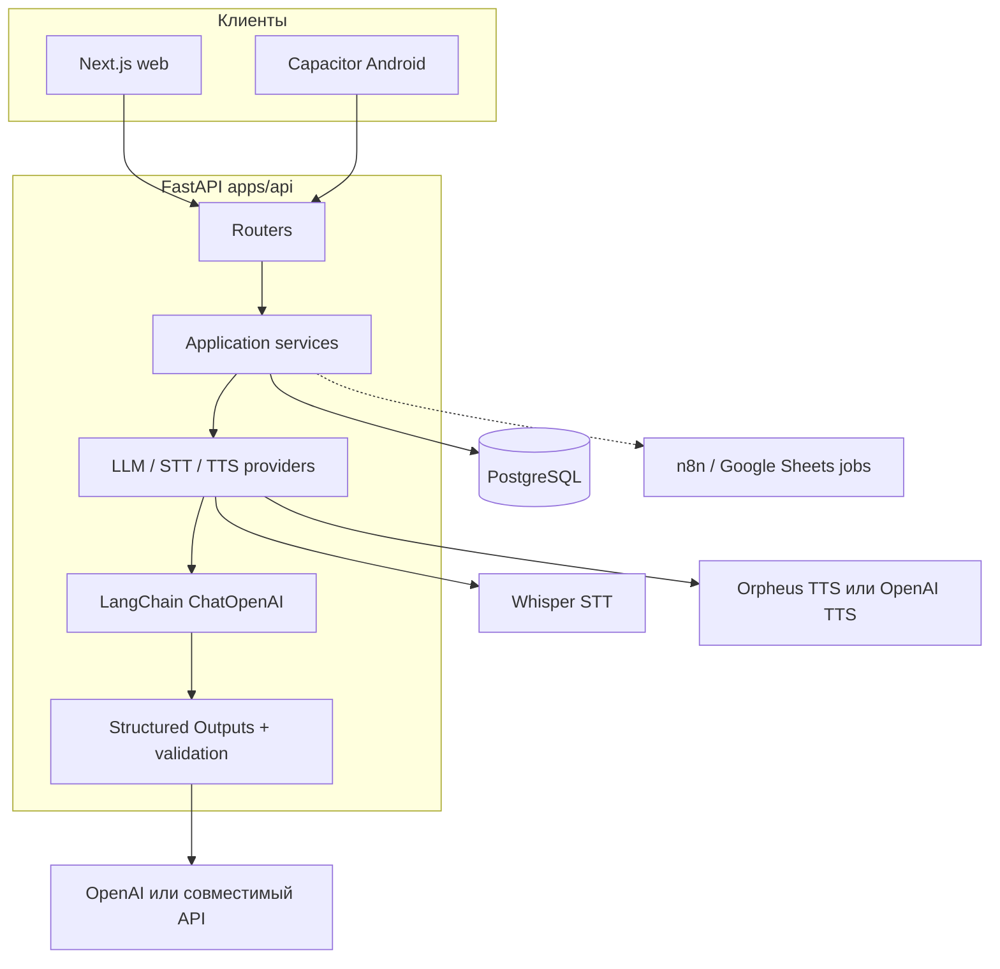

# Decime UY — прикладной AI-ассистент перевода для уругвайского испанского

Приложение для перевода: локально-ориентированный LLM-перевод, речь, личный словарь для тренировки, пайплайны оценки качества и версионирование промптов, тестирования моделей.

[English README](README.md) · [Инженерный case study](docs/case-study.ru.md) · [Индекс документации](docs/README.md)

---

## Обзор проекта

Универсальные переводчики часто плохо передают уругвайский испанский (риоплатенсе): *voseo*, разговорный регистр и бытовые выражения, важные в WhatsApp и живом общении. Decime закрывает этот разрыв — контекстный перевод в **es-UY**, плюс речь и личный список фраз для практики.

Типичные пользователи - изучающие язык или живущие в среде, где нужен надёжный испанский для повседневного чата (UI на русском или английском). Основные направления: **испанский ↔ русский/английский**, целевая локализация исходящих реплик - уругвайский испанский.

```text
Входящее сообщение или речь → understand / translate → ответ es-UY → аудио → одобрение фраз → review (SRS)
```

---

## Демо

| | URL |
|--|-----|
| Веб-приложение | https://decime.online |

В production нужен вход. Публичная саморегистрация по умолчанию выключена (`AUTH_ALLOW_REGISTRATION=false`). Доступ к аккаунтам контролирует оператор проекта, открытой публичной песочницы нет.

Android (Capacitor): [docs/android_setup.md](docs/android_setup.md). 

---

## Основные возможности

| Область | Что реализовано |
|---------|-----------------|
| **Quick Reply** | Понять входящее испанское сообщение на язык UI; собрать один ответ es-UY (Recommended или Simple A2); аудио, копирование/шаринг (включая WhatsApp на Android), добавление для тренировки |
| **Live Chat** | Сначала микрофон, ES ↔ RU/EN лично, с текстовым fallback; один выход перевода (Внимание! Для распознавания и генерации речи используются небольшие локальные модели в качестве теста, они могут быть недоступны, когда не осуществляется тестирование |
| **Training** | LLM извлекает кандидаты → пользователь одобряет → интервальное повторение |
| **History** | Недавняя активность translate/compose; в production — с Postgres и auth |
| **Auth** | Локально опционально; в production — JWT |

---

## Архитектура



| Компонент | Ответственность |
|-----------|-----------------|
| [`apps/web`](apps/web) | Next.js UI (dev или static export для Capacitor / nginx) |
| [`apps/api`](apps/api) | FastAPI: translate, understand, training, audio, auth, admin |
| [`services/ai/lc/`](apps/api/src/decime_api/services/ai/lc/) | LangChain (`ChatOpenAI`), prompt provider, structured chat |
| Postgres | Auth, история, training, jobs словаря |
| Whisper / Orpheus | Речь; Ollama только для **голосовой** модели Orpheus (не text LLM) Локальные модели могут быть отключены, включаются в период тестирования |
| n8n ↔ Sheets | API и интеграция workflow; частичная реализация |

Подробнее: [docs/project_state.md](docs/project_state.md), [deploy/README.md](deploy/README.md), [docs/langchain_migration_status.md](docs/langchain_migration_status.md).

---

## Инженерные акценты Applied AI

| Возможность | Где смотреть | Статус |
|-------------|--------------|--------|
| LangChain text path | [`services/ai/lc/`](apps/api/src/decime_api/services/ai/lc/), [migration status](docs/langchain_migration_status.md) | Единственный orchestrator (`LLM_ORCHESTRATOR=langchain`) |
| Локальные промпты | [`prompts/`](apps/api/src/decime_api/prompts/), [prompt contracts](docs/prompt_contracts.md) | System + human для translate / understand / extract / normalize |
| Structured Outputs | [`structured_chat.py`](apps/api/src/decime_api/services/ai/lc/structured_chat.py), [`llm_json_schemas.py`](apps/api/src/decime_api/services/ai/llm_json_schemas.py) | JSON Schema + `strict=True` |
| Retry при «чужом» языке | [`openai_llm.py`](apps/api/src/decime_api/services/ai/openai_llm.py), [`reply_language.py`](apps/api/src/decime_api/services/ai/reply_language.py) | Детект source-language ответа и повтор с reinforcement |
| LangSmith Prompt Management | [prompt management](docs/langsmith_prompt_management.md), [`prompt_provider.py`](apps/api/src/decime_api/services/ai/lc/prompt_provider.py) | Коммиты и теги `staging` / `v1-0-0` есть; **runtime по умолчанию `DECIME_PROMPT_SOURCE=local`**; тег `production` не выставлен |
| Snapshot fallback | [`prompts/snapshots/`](apps/api/src/decime_api/prompts/snapshots/) | Только если hub недоступен **и** hash совпадает |
| Eval-эксперименты | [Reports 1–4](docs/llm_eval_report1.md), [`evals/`](apps/api/src/decime_api/evals/) | Артефакты пилота в репозитории; не пересчитываются на каждый deploy |
| Usage / cost | [`llm_pricing.py`](apps/api/src/decime_api/services/analytics/llm_pricing.py) | Версионированный каталог цен; неизвестные модели → `unknown_price` |

Полный разбор: **[Инженерный case study](docs/case-study.ru.md)**.

---

## LLM evaluation — выбранные результаты

Пилот октября 2026. Размеры выборок исследовательские (N=30). Методология: [report 4](docs/llm_eval_report4.md).

### Эксперимент 1 — Human pairwise (только style preservation)

- Направление: **es-UY → русский** (`understand_incoming`)
- Модели: `gpt-5.6-luna` (A) vs `gpt-6-luna` (B)
- Один аннотатор (владелец проекта); **один критерий** — style preservation
- Артефакты: [`report1_human.json`](apps/api/evals/reports/pilot-2026-10/report1_human/report1_human.json)

| Исход | Число |
|-------|------:|
| Предпочтение A (`gpt-5.6-luna`) | 9 |
| Предпочтение B (`gpt-6-luna`) | 18 |
| Equal | 3 |

Сумма меток по кейсам = 30 (9+18+3). Ранее в summary ошибочно было Equal = 0; агрегаты пересобраны из сохранённых меток (без новых вызовов LLM). См. [report 1](docs/llm_eval_report1.md).

### Эксперимент 2 — LLM-as-a-Judge

- Направление: **русский → es-UY** (`translate_to_esuy`)
- 30 кейсов × 2 модели = 60 оценённых переводов; judge = `gpt-5-mini`
- Четыре критерия по шкале 1–5; primary — semantic fidelity
- Артефакты: [`report2_judge.json`](apps/api/evals/reports/pilot-2026-10/report2_judge/report2_judge.json)

| Метрика (среднее) | gpt-5.6-luna | gpt-6-luna |
|-------------------|-------------:|-----------:|
| Semantic fidelity | 4.800 | 4.833 |
| UY naturalness | 4.433 | 4.467 |
| Style preservation | 4.700 | 4.933 |
| No additions/omissions | 4.800 | 4.867 |

Пары по semantic fidelity: **3 A / 4 B / 23 equal**. Небольшие разницы средних при большом числе ничьих **не** трактуются как статистически убедительное превосходство.

### Статистические симуляции (не дополнительные реальные eval)

Report 3 — **симулированные** human-like и judge-like пары (400 + 400) для анализа мощности. Они **не** увеличивают реальную выборку N=30. [Report 3](docs/llm_eval_report3.md).

Текстовая модель по умолчанию после пилота: **`gpt-6-luna`**.

---

## Быстрый старт (локально)

Нужны: Python 3.11+, Node.js 20+, Git. Ключ OpenAI (или совместимого API) для реального перевода. Речь (Whisper / Orpheus) опциональна для text-only запуска.

```bash
git clone https://github.com/Vladimir-Q/decime.git decime
cd decime
cp .env.example .env
```

Минимальный `.env` для текста:

```env
LLM_PROVIDER=openai
OPENAI_API_KEY=sk-...
LLM_ORCHESTRATOR=langchain
STT_PROVIDER=fake
TTS_PROVIDER=fake
AUTH_ENABLED=false
NEXT_PUBLIC_API_BASE_URL=http://localhost:8000
```

`LLM_PROVIDER=fake` — для smoke без ключа (переводы бесполезны).

**Backend**

```bash
cd apps/api
python -m venv .venv
# Windows: .venv\Scripts\activate
# macOS/Linux: source .venv/bin/activate
pip install -e ".[dev,local-stt]"
uvicorn decime_api.main:app --reload --app-dir src --host 127.0.0.1 --port 8000
curl http://localhost:8000/health
```

**Frontend**

```bash
cd apps/web
npm ci
npm run dev
```

Открыть [http://localhost:3000](http://localhost:3000) → **Quick Reply**.

Опционально: [scripts/start_local.sh](scripts/start_local.sh), [local STT](docs/local_stt_setup.md), [Orpheus TTS](docs/orpheus_tts_setup.md).

**Production VM** — отдельный путь (`deploy/`, JWT, Postgres): [deploy/README.md](deploy/README.md), [docs/vm_auth.md](docs/vm_auth.md), [docs/security_brief.md](docs/security_brief.md). Локальный `.env` на VM не использовать.

---

## Тесты и надёжность

| Проверка | Команда / workflow |
|----------|--------------------|
| Бесплатный API suite (Fake LLM) | `cd apps/api && pytest -q` |
| Lint | `ruff check src` |
| Web | `npm run typecheck` && `npm run build` |
| CI | [`.github/workflows/api-tests.yml`](.github/workflows/api-tests.yml), [`web-ci.yml`](.github/workflows/web-ci.yml) |
| Платный OpenAI smoke | [`api-llm-smoke.yml`](.github/workflows/api-llm-smoke.yml) (вручную; нужны secrets) |
| Postgres races для sheets jobs | Opt-in: `DECIME_SHEETS_PG_URL` на БД, в имени которой есть `test` |

Успех unit/integration ≠ полное E2E в production для каждой интеграции (особенно n8n/Sheets и Android на устройстве).

---

## Ограничения и дорожная карта

- Пилоты оценки: **N=30**, **один human-аннотатор** — направленные выводы, не крупный бенчмарк.
- Human Experiment 1: только **style preservation** (не четырёхкритериальная human-рубрика).
- Runtime промптов по умолчанию — **локальные** файлы; резолв тегов LangSmith реализован, но не включён как production default.
- n8n / Google Sheets есть на уровне API/workflow.
- Phase 8 (pre-beta) продолжается — [docs/mvp_tasks.md](docs/mvp_tasks.md).


**Дальше:** [Инженерный case study](docs/case-study.ru.md) · [docs/README.md](docs/README.md) · [AGENTS.md](AGENTS.md)
