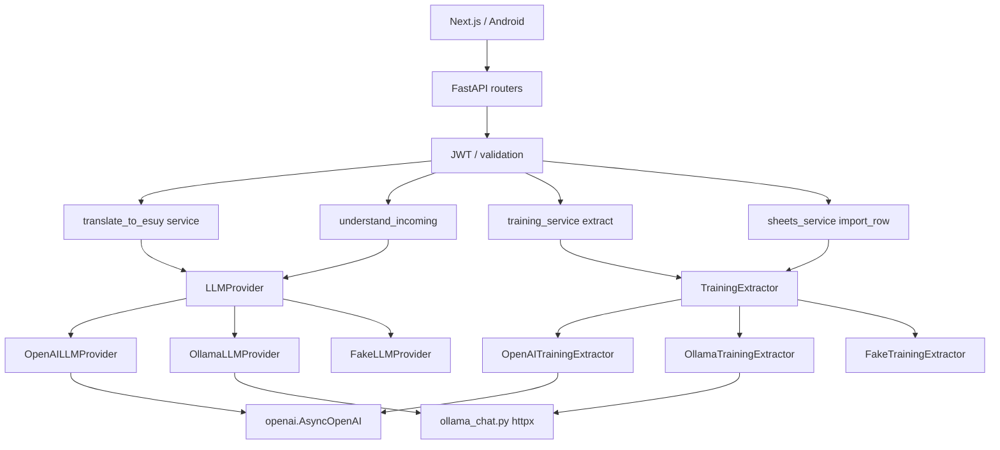

# Decime UY — LangChain / LangSmith / LLM Eval — Stage 0 Audit

**Date:** 2026-10-15  
**Scope:** Backend LLM layer (`apps/api`) only. STT/TTS, Postgres, n8n, frontend unchanged.  
**Status:** AS-IS documented. **No LangChain code landed yet.**

---

## Baseline tests (measured)

```text
Command:  cd apps/api && .venv\Scripts\python.exe -m pytest src/decime_api/tests -q --tb=no
Result:   80 passed, 27 warnings, 5.02s
EXIT:     0
```

Warnings: Starlette `TestClient` deprecation; JWT short secret in test fixtures (pre-existing).

### Installed dependency versions (local `.venv`)

| Package | Declared (`pyproject.toml`) | Installed |
|---------|----------------------------|-----------|
| openai | `>=1.60.0` | **2.38.0** |
| httpx | `>=0.27` | **0.28.1** |
| fastapi | `>=0.115.0` | **0.136.3** |
| pydantic | (via FastAPI) | **2.13.4** |
| langchain* | — | **not installed** |

`apps/api/pyproject.toml` still shows project `version = "0.1.0"` while `decime_api.__version__` is `2.5.1` (display version) — unrelated to LLM, noted for later cleanup.

---

## AS-IS: LLM call graph



### Operations (4)

| Operation | Route | Service | Protocol method |
|-----------|-------|---------|-----------------|
| Compose / translate reply | `POST /api/v1/translate/text` | `reply_composer.translate_to_esuy` | `LLMProvider.translate_to_esuy` |
| Understand incoming | `POST /api/v1/incoming/understand-text` | router → provider | `LLMProvider.understand_incoming` |
| Extract training items | `POST /api/v1/training/extract-candidates` (+ add-to-vocab) | `training_service` | `TrainingExtractor.extract_candidates` |
| Normalize dictionary row | n8n import row | `sheets_service.import_row` | `TrainingExtractor.normalize_dictionary_row` |

**Out of LangChain scope (keep as-is):** Whisper STT, Orpheus TTS, `openai_speech.py`, Docker AI power, audio storage.

### Factory

Single wiring: [`dependencies.py`](../apps/api/src/decime_api/dependencies.py) — `get_llm_provider()`, `get_training_extractor()`.  
OpenAI requires `LLM_PROVIDER=openai` **and** `OPENAI_API_KEY`; otherwise Fake.

---

## Prompts

| File | Runtime use |
|------|-------------|
| `prompts/translate_to_esuy.md` | OpenAI + Ollama compose |
| `prompts/understand_incoming.md` | OpenAI + Ollama understand |
| `prompts/extract_training_items.md` | Training extract |
| `prompts/normalize_dictionary_item.md` | Dictionary normalize |
| `prompts/locale_validate_uy.md` | **Not loaded by code** |

User messages also embed mode/fidelity rules duplicated in `openai_llm.py` / `ollama_llm.py`.

---

## Structured output today

- **OpenAI:** `response_format.json_schema` + **`strict: True`** + hand-written schemas in `llm_json_schemas.py` → `Pydantic.model_validate`.
- **Ollama compose/training:** `format: <schema dict>` via `ollama_chat_json`; repair/fallback on bad JSON.
- **Ollama understand:** **plain text** (`ollama_chat_text`), not structured JSON — different path from OpenAI.

Schemas are **not** auto-generated from Pydantic → drift risk under `strict: True`.

### Retries / post-process (must preserve)

| Mechanism | Where |
|-----------|--------|
| Spanish contamination retry | `reply_language.spanish_reply_contaminated` → compose retry |
| Ollama reply normalize | `_normalize_reply_payload` |
| Dialect stamp fill | `build_dialect_stamp` |
| Single-tone strip | `reply_composer._single_reply_for_tone` when `include_variants=False` |
| Ollama understand validity | `_translation_looks_invalid` + prompt variant retry |
| Extraction parse / filter | Ollama `_parse_extraction_bundle`, `parse_normalized_candidate` |

---

## Analytics today (not LangSmith)

- `log_llm_usage` from **`openai_llm.py` only** (`translate_to_esuy`, `understand_incoming`).
- Ollama + training extract: latency logs only, no token/cost rows.
- Product events: `event_log` (e.g. reply generated).

---

## Tests today

Almost all LLM HTTP tests use **FakeLLMProvider / FakeTrainingExtractor** via `conftest` overrides.  
No default CI call to live OpenAI/Ollama for chat LLM.

Relevant files: `test_compose`, `test_incoming`, `test_training`, `test_fake_llm`, `test_history`, `test_reply_language`, `test_ollama_translation_quality`, `test_sheets_dictionary`, `test_schemas`.

---

## Top migration risks

1. **Ollama vs OpenAI `understand_incoming` parity** — structured JSON vs plain text.
2. **Hand JSON Schema vs Pydantic** under OpenAI strict mode.
3. **Post-LLM heuristics** — language check, normalize, extract filters.
4. **Duplicated prompt assembly** across four provider modules.
5. **Analytics gap** — token logging incomplete; avoid double-counting after LangSmith.

---

## TO-BE: thin LangChain adapter (proposed)

**Principle:** Application services and Pydantic API contracts stay; LangChain only replaces *transport + structured invoke* behind existing protocols.

```text
services/ai/
  llm_provider.py              # Protocol unchanged
  training_extractor.py        # Protocol unchanged
  llm_json_schemas.py          # keep until proven generation is safe
  fake_*.py                    # unchanged for free tests

  lc/                          # NEW — Stage 1+
    settings_bridge.py
    structured_chat.py         # ainvoke + schema; OpenAI strict / Ollama format
    openai_chat_backend.py
    ollama_chat_backend.py
    callbacks.py               # latency + usage → existing log_llm_usage
    tracing.py                 # LangSmith env-gated (Stage 5)

  openai_llm.py / ollama_llm.py / *_training_extractor.py
    → delegate invoke to lc/*, keep retries + post-process in Python
```

**Optional flag:** `LLM_ORCHESTRATOR=legacy|langchain` (default `langchain` once stable) for rollback without protocol changes.

**Not in scope for migration:** LangGraph, RAG, vector DB, agents for demo, replacing Whisper/Orpheus.

---

## Migration sequence (confirmed plan)

| Stage | Focus | Gate |
|-------|--------|------|
| **0** | This audit + baseline | Done |
| **1** | Design LCEL adapters; pin package versions from current docs | Design review |
| **2** | OpenAI compose + understand via LangChain | pytest + smoke A/B |
| **3** | Ollama compose + understand | Local model checks |
| **4** | Training extract + normalize | Fake + schema tests |
| **5** | LangSmith tracing (off by default) | Synthetic traces only |
| **6** | Eval datasets + deterministic + judge metrics | Separate paid runs |
| **7** | Test matrix + CI guardrails | No auto paid evals |
| **8** | Docs + diagrams | Final report |

**Production deploy:** only with explicit user approval (brief §1.12).

---

## Living status

See also: [`langchain_migration_status.md`](langchain_migration_status.md) for session continuity.
