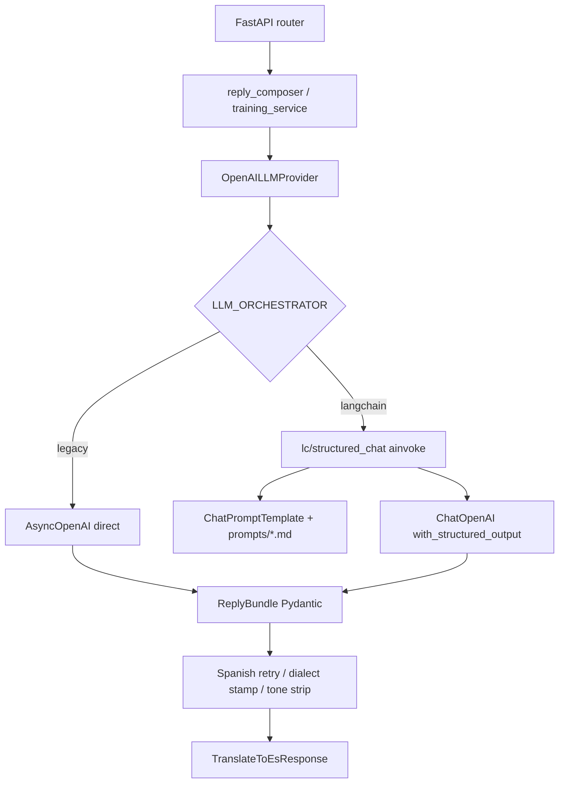

# Stage 1 — LangChain Integration Layer (Architecture Decision)

**Date:** 2026-10-15  
**Status:** Accepted for implementation in Stages 2–4  
**Prerequisite:** [Stage 0 audit](langchain_migration_stage0.md)

---

## 1. Goal

Define a **thin LangChain adapter** under `services/ai/lc/` so Stage 2+ can replace raw OpenAI/Ollama SDK calls **without** changing FastAPI routes, Pydantic API contracts, or business services (`reply_composer`, `training_service`, sheets).

---

## 2. Decision summary

| Topic | Decision |
|-------|----------|
| Boundary | LangChain stays inside provider implementations that already satisfy `LLMProvider` / `TrainingExtractor` |
| Feature flag | `LLM_ORCHESTRATOR=legacy\|langchain` (default **`legacy`**) |
| Packages | Optional extra `[langchain]`; not required for Fake/legacy path |
| OpenAI structured out | Prefer `ChatOpenAI.with_structured_output(..., method="json_schema", strict=True)` |
| Schema source of truth (Stage 2) | Start from **hand JSON schemas** in `llm_json_schemas.py` (same as today). Validate parity vs Pydantic models before switching schema source |
| Ollama understand | Keep **plain-text** path (not forced into structured JSON) behind the same provider method |
| Prompts | Load existing `.md` files; compose with `ChatPromptTemplate` (system + human) |
| Async | Always `ainvoke` from FastAPI async handlers |
| LangGraph / RAG / agents | **Out of scope** |
| LangSmith | Stage 5 only; env-gated; off by default |
| Production | No deploy without explicit approval |

---

## 3. Pinned package targets (PyPI check 2026-10-15)

| Package | Pin (minimum for Stage 2 install) | Notes |
|---------|-----------------------------------|--------|
| `langchain-core` | `>=1.6.10,<2` | LCEL / Runnable / prompts |
| `langchain-openai` | `>=1.7.2,<2` | `ChatOpenAI`; requires `openai>=2.45` |
| `langchain-ollama` | `>=1.1.0,<2` | `ChatOllama` |
| `langsmith` | `>=0.14.0,<1` | Tracing Stage 5 (transitive often enough; declare explicitly) |
| `openai` | bump to `>=2.45.0,<4` when installing `[langchain]` | Current venv has 2.38.0 |

Install (local, Stage 2+):

```bash
cd apps/api
pip install -e ".[dev,langchain]"
```

Default CI / Fake tests continue with `LLM_ORCHESTRATOR=legacy` and **without** requiring LangChain installed (lazy imports).

---

## 4. Concepts (for Decime)

### LangChain vs OpenAI SDK

- **SDK today:** `AsyncOpenAI.chat.completions.create(...)` in `openai_llm.py`.
- **LangChain:** wraps the same models as `Runnable` objects you can compose (`prompt | model | parser`) and swap (`ChatOpenAI` ↔ `ChatOllama`) behind one call shape (`ainvoke`).
- **What we keep outside LangChain:** dialect stamp, Spanish contamination retry, training candidate filters, Postgres history — Decime business rules.

### LCEL / Runnable

`prompt | structured_model` is a **Runnable** pipeline. `ainvoke(input)` runs it asynchronously — required so FastAPI event loop is not blocked.

### `with_structured_output`

Asks the model to return data matching a schema. OpenAI path uses native **json_schema + strict** (closest to current `response_format`).  
**Risk:** Pydantic models with defaults / nested nullability may not match OpenAI strict rules. Therefore Stage 2 compares generated schema to `llm_json_schemas.py` before deleting hand schemas.

### Model adapter + DI

Unchanged: routers depend on `LLMProvider`; `dependencies.get_llm_provider()` picks Fake / OpenAI / Ollama. Orchestrator flag only changes **how** OpenAI/Ollama providers call the model.

---

## 5. Target request flow (TO-BE)



---

## 6. Module layout (`services/ai/lc/`)

| Module | Responsibility |
|--------|----------------|
| `orchestrator.py` | `use_langchain()` from settings; no heavy imports |
| `prompt_loader.py` | Read/cache `prompts/*.md` |
| `types.py` | Shared result types / operation names for tracing later |
| `structured_chat.py` | Stage 2+: build prompt \| model \| structured invoke |
| `openai_backend.py` | Stage 2: construct `ChatOpenAI` from settings |
| `ollama_backend.py` | Stage 3: construct `ChatOllama`; plain vs structured helpers |
| `callbacks.py` | Stage 2+: map usage metadata → `log_llm_usage` (avoid double count) |
| `tracing.py` | Stage 5: LangSmith env helpers (no-op when disabled) |

**Not created:** generic “Agent”, “Memory”, “VectorStore”, or multi-chain orchestrator.

---

## 7. Alternatives considered

| Option | Why rejected / deferred |
|--------|-------------------------|
| Rewrite services to call LangChain directly | Couples business logic to LC; harder Fake tests |
| Replace protocols with LangChain interfaces | Breaks DI and routers |
| LangGraph for compose modes | Overkill for two prompt modes |
| Auto-generate schema only from Pydantic day 1 | High risk under OpenAI `strict` vs current hand schemas |
| Force Ollama understand into JSON schema | Diverges from current quality path |

---

## 8. Stage 1 deliverables in repo

- This ADR
- Config + `.env.example` for `LLM_ORCHESTRATOR`
- Optional `[project.optional-dependencies] langchain`
- Skeleton `lc/` modules (lazy; no runtime change while `legacy`)
- Unit test: default orchestrator is `legacy`

## 9. Exit criteria for Stage 1

- [x] Architecture written and accepted by user (flag agreed)
- [x] Package pins documented from PyPI
- [x] Skeleton + settings land without breaking baseline pytest
- [ ] Stage 2 may begin: OpenAI compose/understand behind flag
