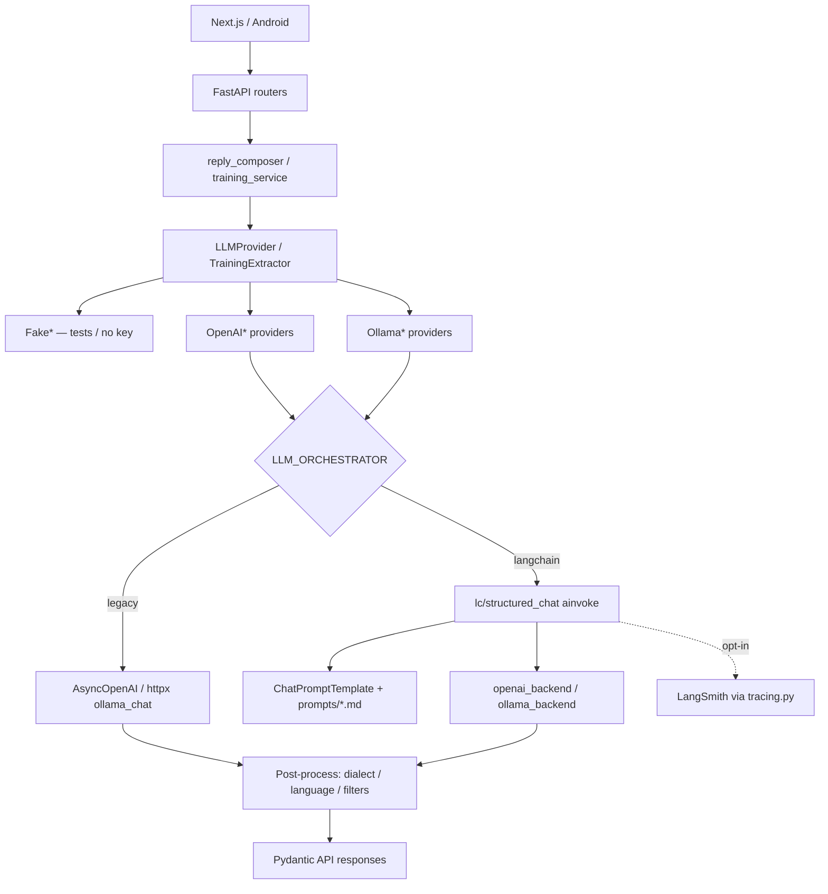

# Stage 8 — Docs + runbooks

**Date:** 2026-10-16 (banner updated 2026-10-17)  
**Status:** Complete — LangChain migration Stages 0–8 closed  
**Audience:** Technical reviewers, new contributors, operators

> **Current product (post-migration):** Text uses **only** LangChain `ChatOpenAI` (official OpenAI or `OPENAI_TEXT_BASE_URL`). There is **no** `LLM_ORCHESTRATOR=legacy` rollback, **no** Ollama text backend, and **no** optional `[langchain]` pip extra (deps are core). Sections below that describe dual orchestrators / ChatOllama / rollback are **historical**. Living index: [langchain_migration_status.md](langchain_migration_status.md).

---

## 1. One-paragraph summary

Decime keeps FastAPI routes, Pydantic contracts, and business rules (es-UY dialect, Spanish contamination retry, training filters) outside LangChain. A thin adapter under `services/ai/lc/` invokes OpenAI-compatible chat via LangChain (`LLM_ORCHESTRATOR=langchain`). LangSmith tracing and paid evals are **opt-in**, gated for production, and excluded from default CI. Free pytest (Fake providers) remains the merge gate.

---

## 2. Architecture (final)



### What LangChain owns

| Concern | Module |
|---------|--------|
| Feature flag | `lc/orchestrator.py` → `use_langchain()` |
| Prompt load + LCEL chain | `lc/prompt_loader.py`, `lc/structured_chat.py` |
| ChatOpenAI / ChatOllama | `lc/openai_backend.py`, `lc/ollama_backend.py` |
| Usage/latency callbacks | `lc/callbacks.py` |
| LangSmith gates + run config | `lc/tracing.py` |

### What stays outside LangChain

- Dialects, tone strip, Cyrillic/Spanish heuristics  
- History / Postgres / auth / rate limits  
- STT (Whisper) / TTS (Orpheus or OpenAI speech)  
- Fake providers for free tests  

### Operations covered

| Operation | Protocol | Legacy | LangChain |
|-----------|----------|--------|-----------|
| Compose reply | `LLMProvider.translate_to_esuy` | SDK structured | `with_structured_output` / Ollama format |
| Understand incoming | `LLMProvider.understand_incoming` | SDK / plain Ollama text | Same split preserved |
| Extract training | `TrainingExtractor.extract_candidates` | SDK | LC structured |
| Normalize dictionary row | `TrainingExtractor.normalize_dictionary_row` | SDK | LC structured |

---

## 3. Decision log

| Decision | Choice (current) |
|----------|------------------|
| Boundary | Adapter behind existing protocols — no route rewrites |
| Orchestrator | `langchain` only (`legacy` rejected by settings) |
| Packages | LangChain deps in **core** `pyproject.toml` |
| Schemas | Hand JSON schemas + structured chat |
| Text backends | OpenAI / OpenAI-compatible `ChatOpenAI` only |
| Ollama | Orpheus TTS voice host only — not text |
| LangGraph / RAG / agents | Out of scope |
| LangSmith | Off by default; prod needs `LLM_TRACING_ALLOW_PRODUCTION` |
| CI paid LLM | Manual `workflow_dispatch` only |

---

## 4. Runbook — local text LLM (current)

```bash
cd apps/api
pip install -e ".[dev,local-stt]"
```

`.env` (repo root):

```env
LLM_PROVIDER=openai
LLM_ORCHESTRATOR=langchain
OPENAI_API_KEY=sk-...
# OPENAI_TEXT_BASE_URL=   # optional compatible endpoint
```

Restart API → `GET /health` should show `"llm_orchestrator": "langchain"`.

There is **no** orchestrator rollback. Optional Fake eval (no keys):

```bash
python scripts/run_llm_eval.py --provider fake --suites compose_ru_esuy
```

---

## 5. Runbook — LangSmith (synthetic only)

See also: [langchain_migration_stage5.md](langchain_migration_stage5.md).

```env
LLM_ORCHESTRATOR=langchain
LLM_TRACING_ENABLED=true
LANGSMITH_API_KEY=lsv2_...
LANGSMITH_PROJECT=decime-local
LANGSMITH_HIDE_IO=true          # keep true until PII policy exists
LLM_TRACING_ALLOW_PRODUCTION=false
```

1. Restart API → `/health` → `llm_tracing: true`.  
2. Call compose/understand with **synthetic** text only.  
3. LangSmith UI → runs `decime.translate_to_esuy`, tags `decime`.  
4. Turn off: `LLM_TRACING_ENABLED=false`.

**Never** enable tracing on production with real chat content without an approved masking policy.

---

## 6. Runbook — evaluation

See also: [langchain_migration_stage6.md](langchain_migration_stage6.md).

```bash
cd apps/api

# Free wiring check
python scripts/run_llm_eval.py --provider fake

# Paid compose (budget-aware)
python scripts/run_llm_eval.py --provider openai --suites compose_ru_esuy

# Optional judge (extra cost)
python scripts/run_llm_eval.py --provider openai --suites compose_ru_esuy --judge
```

Reports: `apps/api/evals/reports/`. Datasets: `apps/api/evals/datasets/v1/`.

---

## 7. Runbook — tests & CI

See also: [langchain_migration_stage7.md](langchain_migration_stage7.md).

```bash
cd apps/api
.\.venv\Scripts\pytest.exe -q                 # free (~103)
.\.venv\Scripts\pytest.exe -m eval -q         # opt-in eval marker
DECIME_LLM_SMOKE=1 OPENAI_API_KEY=... .\.venv\Scripts\pytest.exe -m smoke_llm -q
```

| Workflow | Trigger | Cost |
|----------|---------|------|
| `.github/workflows/api-tests.yml` | push/PR `apps/api/**` | Free |
| `.github/workflows/api-llm-smoke.yml` | manual dispatch | Paid (`OPENAI_API_KEY` secret) |

---

## 8. Stage map (index)

| Stage | Doc |
|-------|-----|
| 0 Audit | [langchain_migration_stage0.md](langchain_migration_stage0.md) |
| 1 Design | [langchain_migration_stage1.md](langchain_migration_stage1.md) |
| 2 OpenAI | [langchain_migration_stage2.md](langchain_migration_stage2.md) |
| 3 Ollama | [langchain_migration_stage3.md](langchain_migration_stage3.md) |
| 4 Training | [langchain_migration_stage4.md](langchain_migration_stage4.md) |
| 5 LangSmith | [langchain_migration_stage5.md](langchain_migration_stage5.md) |
| 6 Eval | [langchain_migration_stage6.md](langchain_migration_stage6.md) |
| 7 CI / markers | [langchain_migration_stage7.md](langchain_migration_stage7.md) |
| **8 Docs (this)** | [langchain_migration_stage8.md](langchain_migration_stage8.md) |
| Living status | [langchain_migration_status.md](langchain_migration_status.md) |

---

## 9. Key talking points

1. **Replaceable providers** — Fake / OpenAI / Ollama behind one protocol; LC is a transport swap, not a rewrite.  
2. **Safe defaults** — legacy orchestrator, tracing off, no auto paid CI.  
3. **Measurable quality** — versioned JSONL evals + deterministic metrics before optional judge.  
4. **Privacy-aware observability** — LangSmith hide-IO + production double-gate.  
5. **Locale product focus** — es-UY Montevideo post-processing stays first-class Python, not prompt-only.

---

## 10. Explicit non-goals (still)

- LangGraph multi-agent demos  
- Vector RAG / embeddings store  
- Replacing Whisper or Orpheus with LangChain tools  
- Shipping `LLM_ORCHESTRATOR=langchain` to `decime.online` without a separate approval + smoke
