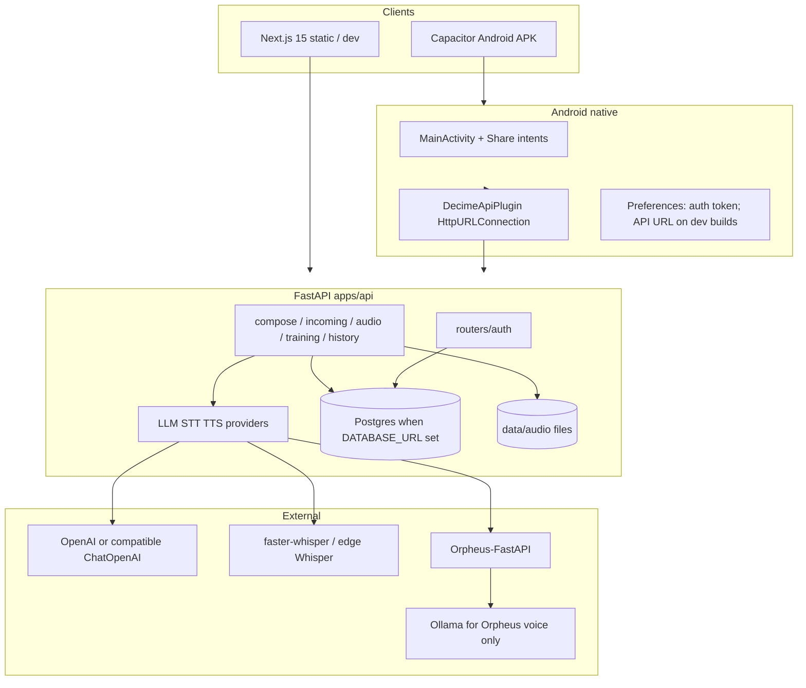

# Decime UY — Технический отчёт о состоянии разработки

**Дата:** 2026-10-17 (согласование с кодом; исходный отчёт 2026-06-24)  
**Репозиторий:** `decime/` (monorepo)  
**Аудитория:** разработчики, DevOps

> Актуальный снимок: [project_state.md](../project_state.md). Ниже — технический обзор; числа тестов и детали storage обновляйте по `project_state` / CI.

---

## Production snapshot

| Component | Value |
|-----------|-------|
| Web | `https://decime.online` (static Next.js export, Caddy) |
| API | `https://api.decime.online` (FastAPI, auth required) |
| DB | PostgreSQL 16 (Docker, migrations on startup) |
| LLM | OpenAI / OpenAI-compatible via LangChain (`gpt-6-luna` typical); **no Ollama text** |
| STT | faster-whisper and/or edge Whisper (Tailscale) |
| TTS | Orpheus (edge or in-VM; Ollama = voice model host only) |
| Tests | ~100 free pytest (`LLM_PROVIDER=fake`); 14 E2E on VM (`scripts/vm_internal_e2e.py`) |

**Deploy:** `deploy/docker-compose*.yml` with `--profile tunnel`. Sync code via `tar` + `docker compose up -d --build web api`.

---

## 1. Архитектура (как есть)



---

## 2. Репозиторий

| Путь | Стек | Назначение |
|------|------|------------|
| `apps/web/` | Next.js 15, React, TypeScript | UI, static export для Capacitor |
| `apps/web/android/` | Capacitor 7, Java | APK, Share, native HTTP |
| `apps/api/` | FastAPI, Python 3.11+ | REST API, AI orchestration |
| `supabase/migrations/` | SQL | Схема Postgres (не в runtime по умолчанию) |
| `docs/` | Markdown | Briefs, contracts, setup |
| `scripts/` | Python, PowerShell | E2E Android, icons, create_admin |

**Тесты API:** ~100 free pytest (fake providers; conftest исключает `smoke_llm` + `eval`). Web CI: typecheck + `npm run build`.

---

## 3. HTTP API — полный перечень

**Base:** `/api/v1`  
**Auth:** при `AUTH_ENABLED=false` (default) защищённые маршруты открыты. При `true` — нужен `Authorization: Bearer <jwt>`, кроме `/health` и `/api/v1/auth/*`.

### 3.1 Public

| Method | Path | Описание |
|--------|------|----------|
| GET | `/health` | status, env, auth_enabled, llm/stt/tts providers |
| GET | `/api/v1/auth/config` | auth_enabled, allow_registration |
| POST | `/api/v1/auth/login` | JWT |
| POST | `/api/v1/auth/register` | JWT (если разрешено) |

### 3.2 Protected (compose, training, audio, history)

| Method | Path | Описание |
|--------|------|----------|
| POST | `/api/v1/translate/text` | Генерация ответа es-UY |
| POST | `/api/v1/incoming/understand-text` | Перевод входящего ES |
| GET | `/api/v1/history` | Список compose history |
| DELETE | `/api/v1/history` | Очистка history + training + audio cache |
| POST | `/api/v1/audio/transcribe` | multipart STT |
| POST | `/api/v1/audio/synthesize` | TTS JSON |
| GET | `/api/v1/audio/files/{audio_id}` | Отдача файла |
| POST | `/api/v1/training/extract-candidates` | LLM extract |
| POST | `/api/v1/training/approve-candidates` | Сохранение + TTS items |
| GET | `/api/v1/training/lists` | Списки + due_count |
| GET | `/api/v1/training/items?list_id=` | Items |
| GET | `/api/v1/training/review/next?list_id=&limit=` | Очередь review |
| POST | `/api/v1/training/review/submit` | Оценка + SRS |

### 3.3 Admin (auth + role admin)

| Method | Path | Описание |
|--------|------|----------|
| GET | `/api/v1/auth/me` | Текущий пользователь |
| GET | `/api/v1/auth/users` | Список users |
| POST | `/api/v1/auth/users` | Создать user |
| PATCH | `/api/v1/auth/users/{user_id}` | Обновить role/active/password |

Контракты: [api_contracts.md](../api_contracts.md), auth: [vm_auth.md](../vm_auth.md).

---

## 4. AI-провайдеры (конфиг `.env`)

| Роль | Env | Реализации в коде |
|------|-----|-------------------|
| LLM + extract | `LLM_PROVIDER` | `fake`, `openai`, `ollama` |
| STT | `STT_PROVIDER` | `fake`, `openai`, `ollama`, `faster_whisper` |
| TTS | `TTS_PROVIDER` | `fake`, `openai`, `orpheus` |

Промпты: `apps/api/src/decime_api/prompts/` (`translate_to_esuy.md`, `understand_incoming.md`, `extract_training_items.md`).

---

## 5. Хранение данных

### 5.1 Runtime (фактически используется)

| Хранилище | Что | Персистентность |
|-----------|-----|-----------------|
| **MemoryTrainingRepository** | training lists, items, extractions, review attempts, SRS | ❌ теряется при рестарте API |
| **MemoryHistoryRepository** | compose history | ❌ |
| **LocalAudioStorage** | `data/audio/` — файлы TTS/STT | ✅ на диске |
| **SQLite `data/decime.db`** | таблица `users` (auth) | ✅ только если `AUTH_ENABLED=true` |

Очистка: `DELETE /api/v1/history` сбрасывает memory repos + audio cache.

### 5.2 Опционально (env)

| Условие | Реализация |
|---------|------------|
| `SUPABASE_URL` + `SUPABASE_SERVICE_ROLE_KEY` | `SupabaseHistoryRepository` для compose history |

Training **не** подключён к Supabase в текущем коде.

### 5.3 Схема Postgres (миграции, не runtime)

`supabase/migrations/001_initial_schema.sql`:

- `profiles`, `locale_variants`, `situations`
- `audio_files`, `transcripts`
- `reply_requests`, `reply_outputs`
- `training_lists`, `training_items`, `extraction_runs`, `training_attempts`
- `event_log`

`002_auth_users.sql`: `app_users` (заготовка под Postgres; runtime auth использует SQLite).

Черновик: [database_schema.sql](../database_schema.sql).

### 5.4 Связь auth ↔ бизнес-данные

**Не реализовано:** `user_id` в history/training/audio не фильтруется — все пользователи делят in-memory store на одном инстансе API.

---

## 6. Frontend — маршруты и ключевые модули

### 6.1 Страницы (`apps/web/src/app/`)

См. product report §3. Layout `/app/*` обёрнут в `AuthGate`.

### 6.2 Библиотеки (`apps/web/src/lib/`)

| Модуль | Назначение |
|--------|------------|
| `api.ts` | REST клиент + JWT headers |
| `api-config.ts` | URL API, LAN scan, health probe, `joinApiPath` |
| `auth.ts` | login, token storage, admin user API |
| `native-http.ts` | `DecimeApi.request` на Android |
| `native-audio-upload.ts` | multipart через plugin |
| `native-share.ts` | pending share text/audio |
| `decime-api-native.ts` | Capacitor plugin setup IP |
| `clipboard.ts` | `@capacitor/clipboard` |
| `capacitor-e2e.ts` | состояние для `scripts/android_e2e.py` |

### 6.3 Компоненты

| Компонент | Назначение |
|-----------|------------|
| `QuickReplyForm` | Основной flow |
| `ComposeForm`, `ReplyBundleCard`, `ContextSelector` | Compose |
| `AuthGate` | Проверка JWT |
| `ApiConnectionPanel`, `ApiDiagnosticsPanel` | Diagnostics page |
| `AppNav` | full vs compact (mobile) |
| Training/Review pages | SRS UI |

### 6.4 Сборки

| Команда | Результат |
|---------|-----------|
| `npm run dev` | Next dev, API localhost |
| `npm run build:cap` | Static `out/` + `CAPACITOR_BUILD=1` |
| `npm run cap:apk` | `android/app/build/outputs/apk/debug/app-debug.apk` |

`capacitor.config.ts`: старт `/app/quick-reply/`, `CapacitorHttp` отключён — HTTP через Java plugin.

---

## 7. Android — нативные интерфейсы

### 7.1 Java (`com.decime.uy`)

| Класс | Интерфейс |
|-------|-----------|
| `MainActivity` | `ACTION_SEND` text/plain, audio/*; E2E intents; WebView debug |
| `DecimeApiPlugin` | Capacitor: `request`, `multipartRequest`, `getApiUrl`, `setApiUrl`, `openApiSetup` |
| `ApiConfigHelper` | normalize URL, prefs, setup dialog |
| `ShareReceiveHelper` | парсинг share payload |

### 7.2 Capacitor plugins (npm)

- `@capacitor/app`, `clipboard`, `preferences`, `share`

### 7.3 E2E

`scripts/android_e2e.py` — 5 сценариев на эмуляторе (`DECIME_E2E_STATE` в logcat).

---

## 8. Аутентификация (технически)

| Параметр | Default | Описание |
|----------|---------|----------|
| `AUTH_ENABLED` | `false` | Вкл. JWT на protected routes |
| `AUTH_DATABASE_PATH` | `data/decime.db` | SQLite users |
| `AUTH_JWT_SECRET` | (сменить в prod) | HS256 |
| `AUTH_BOOTSTRAP_ADMIN_*` | пусто | Первый admin при старте |

Пароли: bcrypt. Токен: PyJWT. Скрипт: `scripts/create_admin.py`.

Frontend: `localStorage` + `Preferences` key `decime_auth_token`.

---

## 9. Интеграционные границы

```text
┌─────────────────┐     HTTPS/HTTP JSON      ┌──────────────────┐
│  Next.js / APK  │ ◄──────────────────────► │  FastAPI :8000   │
└────────┬────────┘     multipart (audio)    └────────┬─────────┘
         │                                              │
         │ Capacitor Plugin                           │ OpenAI API
         ▼                                              │ Ollama :11434
┌─────────────────┐                                    │ Whisper local
│  Java HTTP      │                                    │ Orpheus :5005
└─────────────────┘                                    ▼
                                              ┌──────────────────┐
                                              │  Файлы data/audio │
                                              │  SQLite decime.db │
                                              └──────────────────┘
```

**CORS:** `*` в local; иначе `FRONTEND_BASE_URL` + capacitor origins.

**Нет:** WebSocket, webhooks, Twilio, Palabra, Supabase Auth SDK в frontend.

---

## 10. Качество и CI

| Область | Состояние |
|---------|-----------|
| API unit/integration tests | 39 tests, pytest |
| Android E2E | скрипт вручную + emulator |
| ESLint / Next build | проходит (`build:cap`) |
| LocaleCriticUY | не реализован |
| Structured logging / audit | минимально (uvicorn + plugin logs) |

---

## 11. Конфигурация окружения (основное)

См. `.env.example`: OpenAI, Orpheus, Whisper, auth, `NEXT_PUBLIC_API_BASE_URL`, Supabase (optional).

Рекомендуемый локальный стек (из project_state):

```text
LLM_PROVIDER=openai
STT_PROVIDER=faster_whisper
TTS_PROVIDER=orpheus
AUTH_ENABLED=false
```

---

## 12. Технический долг и backlog

| Приоритет | Задача |
|-----------|--------|
| P0 | Device QA Android + LAN |
| P0 | VM deploy (systemd/docker, HTTPS, firewall) |
| P1 | `user_id` в training/history/audio |
| P1 | Персистентность training (SQLite или Postgres) |
| P2 | Supabase полная интеграция vs self-hosted Postgres |
| P2 | E2E с `AUTH_ENABLED=true` |
| P3 | PWA manifest / service worker |
| P3 | Locale validation step |

---

## 13. Связанные документы

- [README.md](../README.md) — индекс документации  
- [product_status_report.md](product_status_report.md)  
- [development_brief.md](../development_brief.md)  
- [android_setup.md](../android_setup.md)  
- [vm_auth.md](../vm_auth.md)  
- [out_of_scope.md](../out_of_scope.md)  
